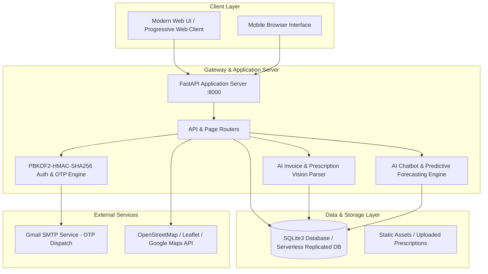
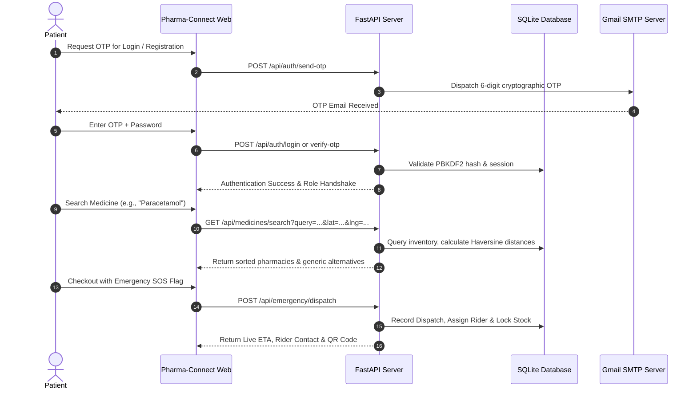
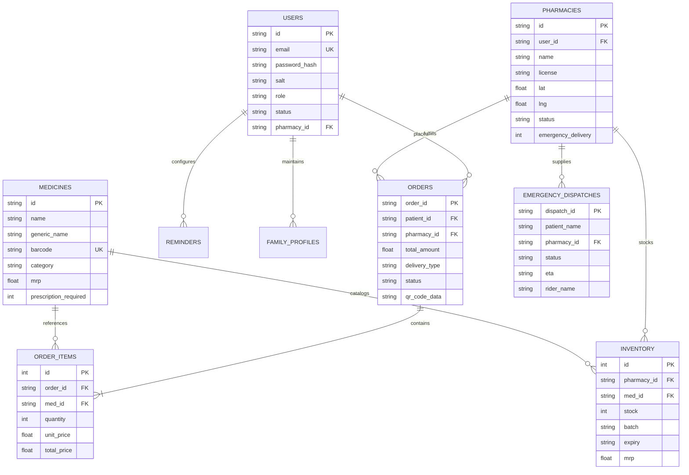

<div align="center">

# 💊 Pharma-Connect AI
### *Next-Generation Real-Time Healthcare & Intelligent Medicine Availability Platform*

[](https://fastapi.tiangolo.com)
[](https://www.python.org/)
[](https://pharmaconnect-ai-hdgu.vercel.app/)
[](https://www.sqlite.org/)
[](LICENSE)
[](https://pharmaconnect-ai-hdgu.vercel.app/)
[](CONTRIBUTING.md)

<p align="center">
  <strong>Pharma-Connect AI</strong> bridges the critical gap between patients, verified pharmacies, and emergency healthcare facilities. Featuring real-time GPS drug availability tracking, AI-powered prescription & invoice scanners, predictive demand forecasting, emergency dispatch routing, and smart medicine donation networks.
</p>

[🌐 Live Demo](https://pharmaconnect-ai-hdgu.vercel.app/) •
[Explore Features](#-key-features) •
[System Architecture](#-system-architecture) •
[Quick Start](#-quick-start-guide) •
[API Documentation](#-api-reference) •
[Demo Credentials](#-demo-accounts) •
[Deployment](#-deployment-guide)

</div>

> [!TIP]
> 🚀 **Live Demo Available:** Test Pharma-Connect AI live in production at **[https://pharmaconnect-ai-hdgu.vercel.app/](https://pharmaconnect-ai-hdgu.vercel.app/)**.  
> Log in directly with any of the pre-seeded [Demo Credentials](#-demo-accounts).

---

## 📑 Table of Contents
- [Overview](#-overview)
- [Key Features](#-key-features)
  - [1. Patient Experience](#1-patient-experience)
  - [2. Pharmacy Partner Portal](#2-pharmacy-partner-portal)
  - [3. Hospital & Emergency Center Network](#3-hospital--emergency-center-network)
  - [4. AI & Machine Intelligence Suite](#4-ai--machine-intelligence-suite)
  - [5. Central Administrator Telemetry](#5-central-administrator-telemetry)
- [System Architecture](#-system-architecture)
  - [High-Level Flowchart](#high-level-flowchart)
  - [Architectural Diagrams](#architectural-diagrams)
- [Database Schema](#-database-schema)
- [Security & Authentication](#-security--authentication)
- [Technology Stack](#-technology-stack)
- [Quick Start Guide](#-quick-start-guide)
  - [Prerequisites](#prerequisites)
  - [One-Click Windows Launch](#one-click-windows-launch)
  - [Manual Setup (Windows / macOS / Linux)](#manual-setup-windows--macos--linux)
- [Environment Configuration](#-environment-configuration)
- [Demo Accounts](#-demo-accounts)
- [API Reference](#-api-reference)
- [Deployment Guide](#-deployment-guide)
  - [Deploy to Render](#deploy-to-render)
  - [Deploy to Vercel](#deploy-to-vercel)
- [Contributing](#-contributing)
- [License](#-license)

---

## 🌟 Overview

During medical crises or chronic treatment regimens, finding critical medicines at nearby pharmacies often involves stressful phone calls and physical visits. At the same time, pharmacies face inventory obsolescence, stockouts of essential formulations, and tedious manual paperwork.

**Pharma-Connect AI** is an enterprise-grade, full-stack healthcare ecosystem designed to address these challenges:
- **Instant Medicine Locator**: Locates specific brands and generic salts across nearby pharmacies using the Haversine distance formula.
- **Emergency SOS Dispatch**: One-click dispatch of life-saving medicines with dynamic courier assignment, live ETA, and GPS routing.
- **AI-Powered Diagnostics & Guidance**: Conversational AI assistant for symptom evaluation, dosage queries, drug interaction checks, and generic substitutes.
- **Computer Vision OCR**: Camera/file upload invoice scanner extracting batches, expiration dates, and quantities directly into stock records.
- **Predictive Analytics**: Machine learning forecasting models alerting pharmacies of imminent stock shortages before they happen.
- **Surplus Medicine Redistribution**: Verified peer-to-NGO medicine donation workflow to minimize healthcare waste.

---

## 🚀 Key Features

### 1. Patient Experience
- **Live Medicine Radar & Fuzzy Search**: Search by commercial brand name, generic chemical composition, or symptom. Filter by distance, 24/7 status, rating, and stock availability.
- **Generic Equivalent Recommender**: Intelligent substitution engine suggesting lower-cost, bioequivalent generic alternatives.
- **One-Click Ordering & QR Verification**: Seamless checkout with pickup or home delivery options. Every order generates a cryptographically signed QR code receipt for contactless pickup verification.
- **Prescription Upload & Verification**: Secure upload portal for digital medical prescriptions with automated review flags.
- **Medication Schedule Alarms**: In-app medication reminders tailored to individual dosages and daily schedules.
- **Family Health Hub**: Centralized profile manager storing medical histories, blood groups, and chronic allergies for family members.
- **Surplus Medicine Donation Portal**: Schedule pickups for unexpired surplus medicines partnered with recognized healthcare NGOs.

### 2. Pharmacy Partner Portal
- **Real-Time Stock & Batch Management**: Track batch numbers, manufacturing dates, expiry dates, and MRP with automated low-stock warnings.
- **AI Optical Invoice Scanner**: Upload distributor invoices or supplier bills; the OCR engine parses medication names, quantities, and batch metadata directly into your live inventory.
- **Order Lifecycle Fulfillment**: Manage incoming standard and emergency orders with status stages: `PENDING` ➔ `CONFIRMED` ➔ `PACKED` ➔ `OUT_FOR_DELIVERY` ➔ `DELIVERED`.
- **Dynamic Pricing Engine**: Adjust MRP, discounts, and inventory availability in real time.

### 3. Hospital & Emergency Center Network
- **B2B Bulk Emergency Reservations**: Hospitals can lock in emergency medicine reservations across partner pharmacy networks during trauma surges.
- **ICU Bed & Trauma Telemetry**: Public transparency on available ICU beds, oxygen facilities, and 24x7 trauma care status.

### 4. AI & Machine Intelligence Suite
- **Medical Triage & Consultation Chatbot**: Context-aware clinical bot trained on pharmaceutical reference guides to answer medication queries, precautions, and contraindications.
- **Predictive Demand & Stockout Analytics**: Trend algorithms analyze seasonal outbreak cycles (e.g., monsoon fevers, viral waves) to predict medicine depletion trajectories up to 30 days in advance.

### 5. Central Administrator Telemetry
- **Pharmacy Verification Pipeline**: Review drug licenses (e.g., Form 20/21) and inspect geo-coordinates before approving new pharmacy registrations.
- **Account Governance**: Suspend or activate user and pharmacy accounts with immediate session revocation.
- **Audit Trails**: Immutable timestamped event logs for regulatory compliance and audit readiness.
- **Integrated Email OTP Engine**: Configure production Gmail SMTP keys directly within the admin console.

---

## 🏗 System Architecture

Pharma-Connect AI leverages an asynchronous, high-throughput backend paired with a reactive frontend and relational storage.



### High-Level Flowchart


### Architectural Diagrams
High-resolution engineering diagrams are included in the repository under [`docs/diagrams/`](docs/diagrams/):

| Diagram | Description | View |
| :--- | :--- | :--- |
| **System Block Diagram** | Component-level integration and sub-system boundaries | [docs/diagrams/Block_Diagram.jpg](docs/diagrams/Block_Diagram.jpg) |
| **Data Flow Diagram (DFD)** | Level-0 and Level-1 data flows between external entities and storage | [docs/diagrams/DFD_Diagram.jpg](docs/diagrams/DFD_Diagram.jpg) |
| **Operational Flowchart** | Complete state-machine logic from user search to order fulfillment | [docs/diagrams/Flowchart.jpg](docs/diagrams/Flowchart.jpg) |
| **UML Class Diagram** | Entity-Relationship and schema structural design | [docs/diagrams/UML_Diagram.jpg](docs/diagrams/UML_Diagram.jpg) |

---

## 🗄 Database Schema

The platform runs on a optimized relational schema initialized via [`db.py`](db.py):



---

## 🔐 Security & Authentication

- **PBKDF2 Password Hashing**: Passwords are salted with 128-bit cryptographically secure salts and derived using 120,000 PBKDF2 iterations with HMAC-SHA256.
- **Account Lockout Policy**: Defends against brute-force attacks by locking accounts for 15 minutes after 5 sequential failed login attempts.
- **Time-Sensitive OTP Verification**: One-Time Passwords generated via `secrets` module expire strictly within 10 minutes and can only be redeemed once.
- **Role-Based Access Control (RBAC)**: Fine-grained middleware authorization ensuring patients cannot manipulate pharmacy inventories, and pharmacy users cannot access central admin telemetry.
- **Serverless Safe Storage**: Automatic fallback and synchronisation to `/tmp` storage when deployed in AWS Lambda or Vercel serverless environments.

---

## 💻 Technology Stack

| Layer | Technologies |
| :--- | :--- |
| **Backend Framework** | [FastAPI](https://fastapi.tiangolo.com/) (Asynchronous Python 3.10+) |
| **Server Engine** | [Uvicorn](https://www.uvicorn.org/) (ASGI), [Gunicorn](https://gunicorn.org/) (WSGI/Worker) |
| **Database** | [SQLite3](https://sqlite.org/) with relational foreign keys and indices |
| **Templating Engine**| [Jinja2](https://jinja.palletsprojects.com/) |
| **Frontend Stack** | Modern Vanilla JavaScript (ES6+ async/await), HTML5 Semantic markup |
| **Styling & UI** | Custom Responsive CSS3, Glassmorphism, Theme Variables, Micro-animations |
| **Geospatial Engine**| Haversine distance matrix algorithm, Leaflet / OpenStreetMap |
| **Communication** | Python `smtplib` SSL protocol for Gmail OTP delivery |
| **Deployment** | Vercel (`@vercel/python`), Render (`render.yaml`), Docker/Heroku (`Procfile`) |

---

## ⚡ Quick Start Guide

### Prerequisites
- **Python 3.10+** installed ([Download here](https://www.python.org/downloads/))
- **Git** installed on your system

---

### One-Click Windows Launch
If you are running Windows, double-click the included automation launcher:

```bat
start.bat
```
*or via PowerShell:*
```powershell
.\start.ps1
```
*This script automatically creates a virtual environment (`venv`), installs all required dependencies, initializes the database with demo records, and opens `http://localhost:8000` in your default browser.*

---

### Manual Setup (Windows / macOS / Linux)

#### 1. Clone the repository
```bash
git clone https://github.com/Shreyash-Techspace/pharmaconnect-ai.git
cd pharmaconnect-ai
```

#### 2. Create and activate a Virtual Environment
```bash
# Windows
python -m venv venv
venv\Scripts\activate

# macOS / Linux
python3 -m venv venv
source venv/bin/activate
```

#### 3. Install Dependencies
```bash
pip install -r requirements.txt
```

#### 4. Configure Environment Variables
```bash
# Copy sample configuration
cp .env.example .env
```
*(Open `.env` in your editor and add your Gmail credentials for real OTP emails. If omitted, OTPs will print to your terminal console for local debugging).*

#### 5. Initialize the Database
```bash
python -c "import db; db.init_db(); print('Database initialized successfully.')"
```

#### 6. Run the Application
```bash
uvicorn main:app --host 0.0.0.0 --port 8000 --reload
```

Open your browser at **[http://localhost:8000](http://localhost:8000)**.  
Interactive OpenAPI documentation is live at **[http://localhost:8000/docs](http://localhost:8000/docs)**.

---

## ⚙ Environment Configuration

Create a `.env` file in the root directory. You can copy the template from [`.env.example`](.env.example):

| Variable | Description | Default / Example |
| :--- | :--- | :--- |
| `GMAIL_USER` | Your Gmail address for sending OTP emails | `your-name@gmail.com` |
| `GMAIL_APP_PASSWORD`| 16-character Google App Password (not your normal password) | `xxxx xxxx xxxx xxxx` |
| `GOOGLE_MAPS_API_KEY`| *(Optional)* Google Maps API key (Leaflet works out-of-the-box without this) | `AIzaSy...` |
| `SECRET_KEY` | Session signing cryptographic key | `pharma-connect-ai-secret-key-2026` |

> [!TIP]
> **How to create a Gmail App Password:**
> 1. Visit your [Google Account Security settings](https://myaccount.google.com/security).
> 2. Ensure **2-Step Verification** is enabled.
> 3. Go to [App Passwords](https://myaccount.google.com/apppasswords).
> 4. Generate an App Password for **Mail** / **Windows Computer**, and paste the 16 characters into `GMAIL_APP_PASSWORD`.

---

## 👥 Demo Accounts

The platform comes pre-seeded with active test credentials across all healthcare roles. You can test these instantly on the [Live Web Application](https://pharmaconnect-ai-hdgu.vercel.app/login):

| Role | Email Address | Password | Details / Permissions |
| :--- | :--- | :--- | :--- |
| 🧑‍⚕️ **Patient** | `rahul@pharmaconnect.ai` | `PatientPass@123` | Patient dashboard, medicine ordering, donation submission |
| 💊 **Pharmacy Owner** | `apollo@pharmaconnect.ai` | `PharmaPass@123` | Apollo Pharmacy (Downtown), inventory & invoice upload |
| 🏥 **Hospital Admin** | `healthplus@pharmaconnect.ai` | `PharmaPass@123` | HealthPlus Chemist & emergency reservation interface |
| 🛡️ **System Admin** | `admin@pharmaconnect.ai` | `AdminPass@123` | Full administrative telemetry, user moderation & settings |

---

## 📡 API Reference

Explore the full interactive Swagger documentation at `/docs` or ReDoc at `/redoc`. Below is a summary of key REST endpoints:

### Authentication & User Management
| Method | Endpoint | Description |
| :--- | :--- | :--- |
| `POST` | `/api/auth/send-otp` | Generate and dispatch 6-digit verification code via Gmail SMTP |
| `POST` | `/api/auth/verify-otp` | Validate submitted OTP code against active sessions |
| `POST` | `/api/auth/login` | Authenticate user with PBKDF2 hash validation & role redirection |
| `POST` | `/api/auth/register` | Register new Patient or Pharmacy Partner account |
| `POST` | `/api/auth/reset-password` | Security-question verified password reset |
| `PUT` | `/api/users/profile` | Update profile information and address |

### Medicine Search & Geolocation
| Method | Endpoint | Description |
| :--- | :--- | :--- |
| `GET` | `/api/medicines/search` | Full-text query on medicines, stock, prices, and nearest stores |
| `GET` | `/api/facilities` | List nearest verified pharmacies and hospitals by GPS coordinates |
| `GET` | `/api/facilities/{id}/medicines` | Query complete inventory catalog for a specific facility |
| `GET` | `/api/pharmacies` | Return list of all approved pharmacies |

### Orders & Emergency Dispatch
| Method | Endpoint | Description |
| :--- | :--- | :--- |
| `POST` | `/api/orders/create` | Place new order with items list, delivery type, and QR generation |
| `GET` | `/api/orders/patient/{id}` | Retrieve patient order history and active tracker status |
| `GET` | `/api/orders/pharmacy/{id}` | Retrieve incoming orders for fulfillment by pharmacy |
| `POST` | `/api/orders/update-status` | Progress order state (`PENDING` ➔ `CONFIRMED` ➔ `DELIVERED`) |
| `POST` | `/api/emergency/dispatch` | Trigger high-priority emergency SOS medicine dispatch |

### AI Suite & Smart Features
| Method | Endpoint | Description |
| :--- | :--- | :--- |
| `POST` | `/api/ai/chatbot` | Conversational clinical triage & dosage query assistant |
| `GET` | `/api/ai/forecasting-analytics` | Predictive demand, depletion alerts, and seasonal stock trends |
| `POST` | `/api/pharmacy/ai-invoice-scanner`| Optical OCR parsing of supplier bills into inventory records |
| `POST` | `/api/prescriptions/upload` | Prescription image upload with automated validation flag |
| `POST` | `/api/donation/submit` | Register surplus medicine donation with preferred NGO partner |

### Admin & System Operations
| Method | Endpoint | Description |
| :--- | :--- | :--- |
| `GET` | `/api/health` | Service health telemetry, database status, and catalog counters |
| `GET` | `/api/admin/all-data` | Master telemetry data feed for administration overview |
| `POST` | `/api/admin/users/toggle-status` | Suspend or activate user account |
| `POST` | `/api/admin/pharmacies/approve/{id}`| Formally approve pending pharmacy license |

---

## 🌐 Deployment Guide

### Deploy to Render
The repository includes a ready-to-use [`render.yaml`](render.yaml) blueprint:
1. Push your repository to GitHub.
2. Sign in to [Render](https://render.com) and click **New > Blueprint**.
3. Select your repository. Render automatically reads `render.yaml`:
   - **Environment**: Python
   - **Build Command**: `pip install -r requirements.txt`
   - **Start Command**: `uvicorn main:app --host 0.0.0.0 --port $PORT`
4. Add your `.env` variables (`GMAIL_USER`, `GMAIL_APP_PASSWORD`) under the service settings.

---

### Deploy to Vercel
Configured for zero-config Vercel Serverless deployment via [`vercel.json`](vercel.json) and [`api/index.py`](api/index.py).  
Our official production deployment is hosted at: **[https://pharmaconnect-ai-hdgu.vercel.app/](https://pharmaconnect-ai-hdgu.vercel.app/)**

1. Install the Vercel CLI:
   ```bash
   npm install -g vercel
   ```
2. Run deploy from root directory:
   ```bash
   vercel
   ```
3. Set your environment variables in the Vercel Dashboard under **Project Settings > Environment Variables**.

---

## 🤝 Contributing

Contributions make the open-source community an incredible place to learn, inspire, and build. Any contributions you make are **greatly appreciated**.

1. Fork the Project
2. Create your Feature Branch (`git checkout -b feature/SmartInventoryAlerts`)
3. Commit your Changes (`git commit -m 'feat: Add automated stock expiration alerts'`)
4. Push to the Branch (`git push origin feature/SmartInventoryAlerts`)
5. Open a Pull Request

---

## 📄 License

Distributed under the MIT License. See `LICENSE` for more information.

---

<div align="center">
  <p>Built with ❤️ to revolutionize accessible healthcare intelligence.</p>
  <p>
    <strong>Pharma-Connect AI Team</strong> • 
    <a href="mailto:support@pharmaconnect.ai">Contact Support</a>
  </p>
</div>
